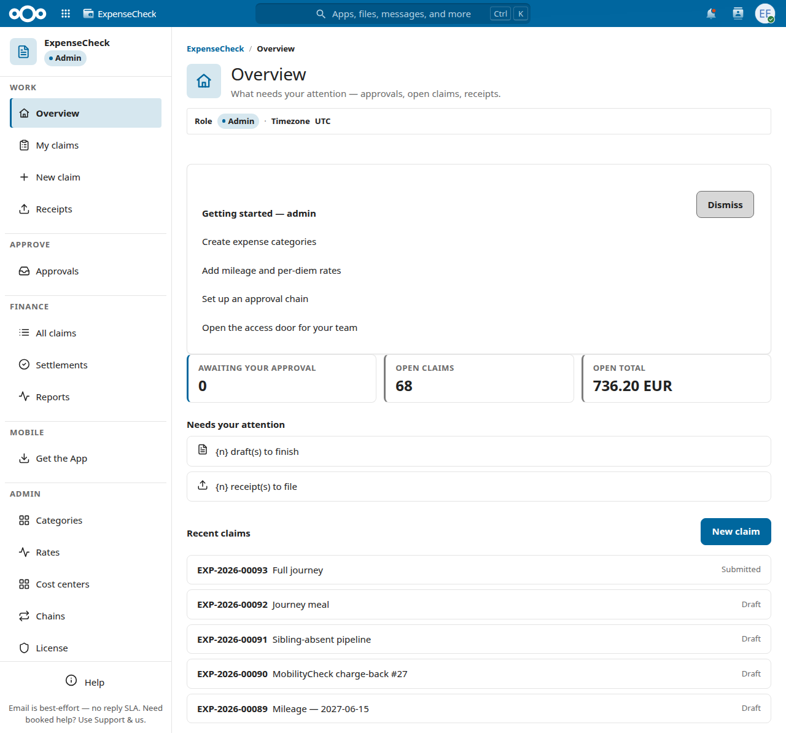
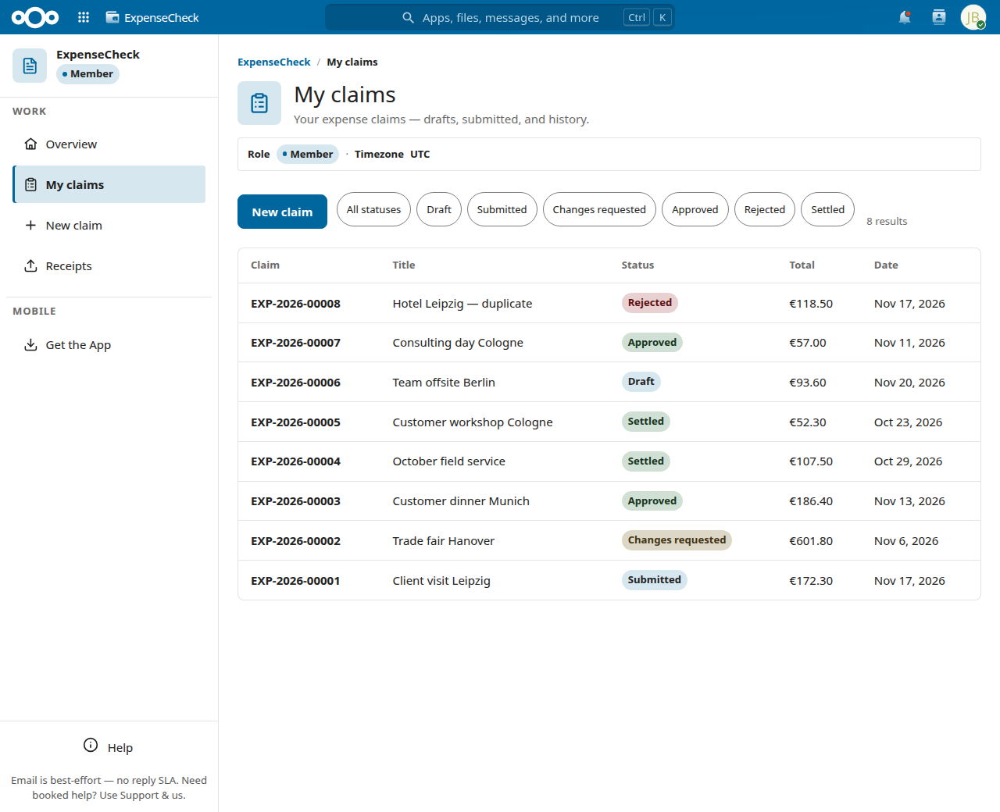
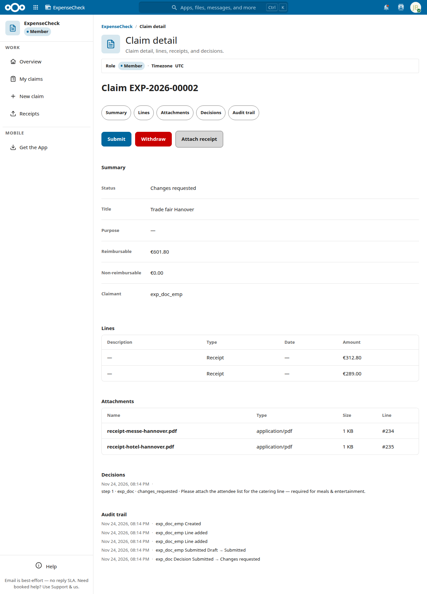
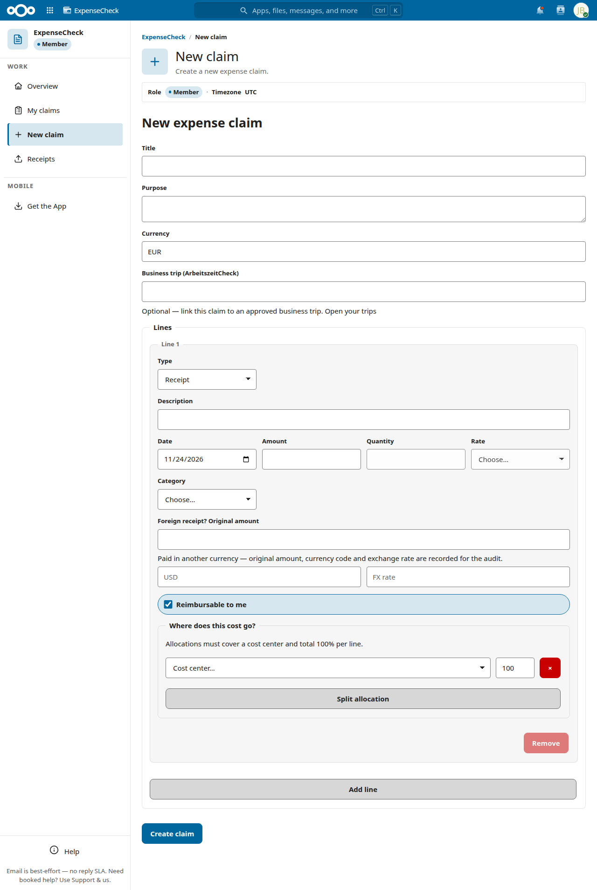
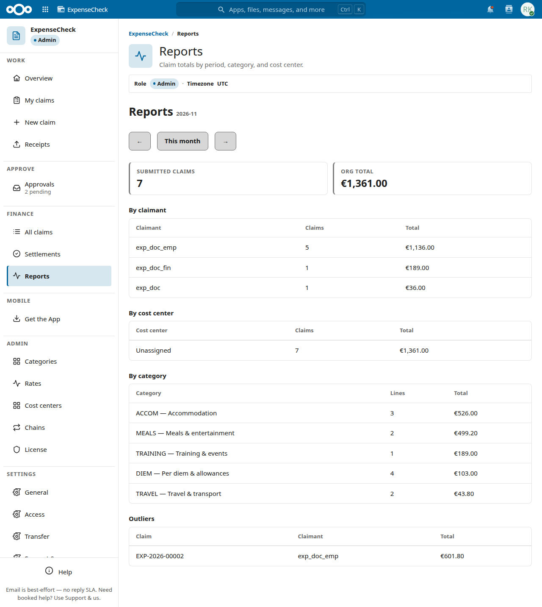
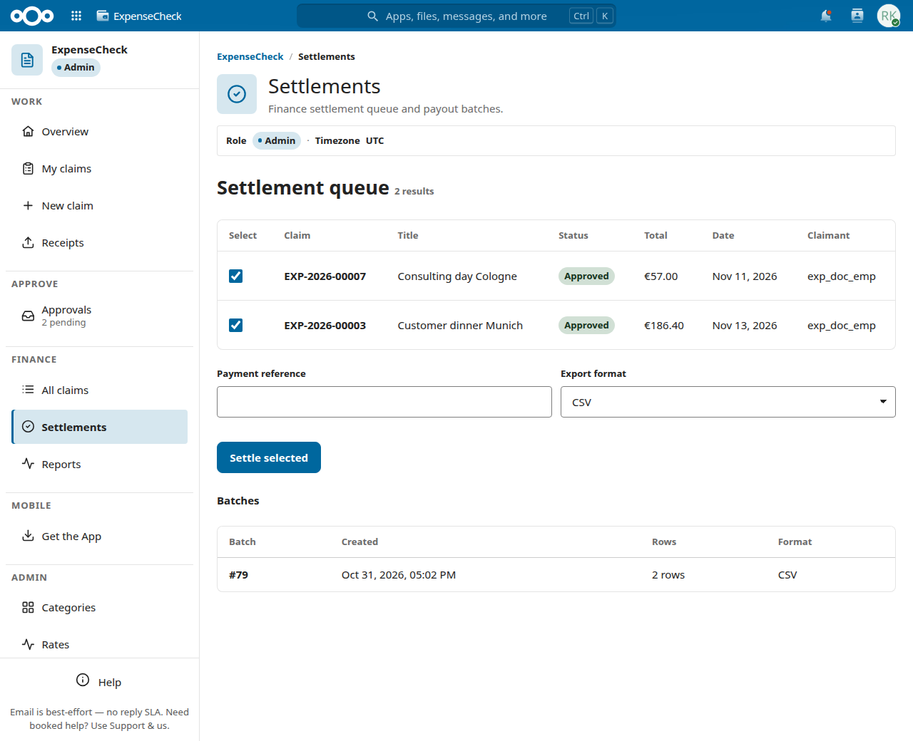

# ExpenseCheck

[](https://nextcloud.com/)
[](https://www.php.net/)
[](LICENSE)

**[English](#english)** · **[Deutsch](#deutsch)**

Claim, approve and reimburse employee expenses — receipts, mileage and per-diem on your Nextcloud.

---

## English

**File. Approve. Reimburse. With a trail.**

ExpenseCheck runs employee expense reimbursement inside your self-hosted Nextcloud: receipt claims with photos, mileage and per-diem via an admin-managed rate catalog, configurable multi-step approval chains, a finance settlement queue with CSV/ODS export, and an append-only hash-chained audit journal.

**Free web app** (AGPL-3.0-or-later). The official Android companion is a licensed add-on (EXP2 seats).

### Why teams install it

- **Claims in under a minute** — receipt, mileage, per-diem and flat lines; receipts inbox for capture-first filing
- **Approval chains your org defines** — 1..N steps by group, named user or line manager; amount/category routing
- **A finance queue that reconciles** — batch settlement with payment references; formula-injection-safe CSV/ODS export
- **Books that can't be silently rewritten** — settled claims immutable, period close, every decision in a hash-chained journal
- **Jurisdiction-agnostic** — every rate, category, tax mode and approval rule is admin-configured; no statutory logic shipped
- **Suite-native** — optional links to ArbeitszeitCheck business trips and the mobility app charge-backs when the siblings are installed

### Clear limits

- Export is the boundary — ExpenseCheck never executes payments.
- No OCR/AI receipt scanning; no bank or card feeds.
- Audit entries are append-only.
- Declared databases: MySQL and PostgreSQL.

### Requirements

- Nextcloud 32–35 · PHP 8.2–8.5 · MySQL or PostgreSQL

### Install from Git

```bash
cd /path/to/nextcloud/apps/
git clone https://github.com/aSoftwareByDesignRepository/nextcloud-expensecheck.git expensecheck
cd expensecheck
composer install --no-dev
```

Enable the app in Nextcloud (Apps → ExpenseCheck) or run `php occ app:enable expensecheck`.

### Screenshots

| Overview | My claims | Claim detail |
| --- | --- | --- |
|  |  |  |

| New claim | Reports | Settlement queue |
| --- | --- | --- |
|  |  |  |

### Security

See [SECURITY.md](SECURITY.md). Do not open public issues that contain production secrets, personal data, or internal hostnames. Report sensitive findings privately to the maintainer (see `appinfo/info.xml` author).

### Project & support

**Software by Design GbR** · [nextcloud.software-by-design.de](https://nextcloud.software-by-design.de/) · [info@software-by-design.de](mailto:info@software-by-design.de)  
[Support packages](https://nextcloud.software-by-design.de/en/support.html#packages)

### License

[AGPL-3.0-or-later](LICENSE). See [CHANGELOG.md](CHANGELOG.md) for the release history.

---

## Deutsch

**Einreichen. Genehmigen. Erstatten. Mit Nachweis.**

ExpenseCheck bildet die Spesenabrechnung für Mitarbeitende in Ihrer selbst gehosteten Nextcloud ab: Belegabrechnungen mit Fotos, Kilometergeld und Verpflegungspauschalen über einen vom Admin gepflegten Tarifkatalog, konfigurierbare mehrstufige Genehmigungsketten, eine Auszahlungswarteschlange mit CSV/ODS-Export und ein manipulationssicheres, hash-verkettetes Prüfjournal.

**Kostenlose Web-App** (AGPL-3.0-or-later). Der offizielle Android-Begleiter ist ein lizenzierter Zusatz (EXP2-Sitzplätze).

### Warum Teams es einsetzen

- **Abrechnung in unter einer Minute** — Beleg-, Fahrtkosten-, Pauschal- und Flatrate-Positionen; Belegeingang für Capture-first
- **Genehmigungsketten nach Ihren Regeln** — 1..N Stufen per Gruppe, Person oder Linienvorgesetzten; Betrags-/Kategorie-Routing
- **Eine Finanzqueue, die stimmt** — Auszahlungsläufe mit Zahlungsreferenz; formelsicherer CSV/ODS-Export
- **Bücher, die nicht still umgeschrieben werden** — ausgezahlte Abrechnungen unveränderlich, Periodenabschluss, jede Entscheidung im hash-verketteten Journal
- **Jurisdiktionsneutral** — jeder Tarif, jede Kategorie, jeder Steuermodus und jede Genehmigungsregel wird vom Admin konfiguriert; keine gesetzlichen Logiken mitgeliefert
- **Suite-nativ** — optionale Verknüpfung mit ArbeitszeitCheck-Dienstreisen und Mobilitäts-App-Rückbelastungen, wenn die Schwester-Apps installiert sind

### Klare Grenzen

- Export ist die Grenze — ExpenseCheck führt keine Zahlungen aus.
- Keine OCR-/KI-Belegerkennung; keine Bank- oder Karten-Feeds.
- Audit-Einträge sind nur anhängbar.
- Deklarierte Datenbanken: MySQL und PostgreSQL.

### Voraussetzungen

- Nextcloud 32–35 · PHP 8.2–8.5 · MySQL oder PostgreSQL

### Lizenz

[AGPL-3.0-or-later](LICENSE).
